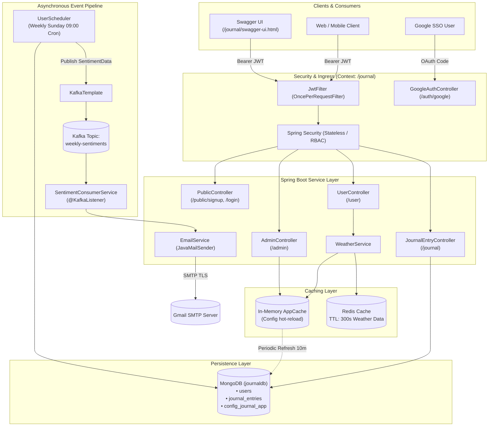

# 📓 JournalApp — Distributed & Secure Journaling Backend

[](https://www.oracle.com/java/)
[](https://spring.io/projects/spring-boot)
[](https://spring.io/projects/spring-security)
[](https://www.mongodb.com/)
[](https://redis.io/)
[](https://kafka.apache.org/)
[](https://swagger.io/)
[](https://sonarcloud.io/)

A production-grade, distributed RESTful backend service for personal journaling with end-to-end user isolation, sentiment analysis, event-driven weekly email digests, multi-tier caching, external telemetry integration, and enterprise-grade security.

---

## 🌟 Key Features

- **🔐 Dual Authentication & Security Engine**:
  - **Stateless JWT Security**: Custom `JwtFilter` with HMAC-SHA token signing, verification, and BCrypt password encryption.
  - **Google OAuth 2.0 Integration**: Single-Sign-On (SSO) callback mechanism automatically provisioning Google users and issuing application JWTs.
  - **Role-Based Access Control (RBAC)**: Distinct permissions for `USER` and `ADMIN` endpoints.
- **📝 Multi-Document Transactional Journaling**:
  - Full CRUD lifecycle for journal entries tied directly to authenticated user profiles.
  - **ACID Transactions**: MongoDB multi-document transactions enabled via `MongoTransactionManager` to maintain consistency between User documents and Journal collections.
- **📊 Sentiment Tagging & Asynchronous Weekly Digest**:
  - Real-time sentiment tagging on individual journal entries (`HAPPY`, `SAD`, `ANGRY`, `ANXIOUS`).
  - **Automated Sunday Cron Engine**: Computes weekly dominant emotional states for subscribed users.
  - **Event-Driven Messaging via Apache Kafka**: Decoupled notification dispatch where sentiment events are streamed to Kafka and ingested asynchronously by dedicated consumers for email distribution.
- **⚡ Two-Level High-Performance Caching Layer**:
  - **Redis Layer**: Response-level caching for external weather lookups with configurable TTL (300s) to minimize rate limits and latency.
  - **Database-Backed AppCache**: Dynamic runtime configuration cache (`config_journal_app`) hot-reloaded every 10 minutes or invalidated on-demand by Admins.
- **⛅ Live Weather Telemetry**:
  - Contextual user greetings enhanced with real-time temperature and weather descriptions fetched dynamically via external Weather APIs.
- **📑 OpenAPI 3.0 & Swagger UI**:
  - Interactive API playground pre-configured with Bearer JWT authorization schemes.
- **🛡️ Production CI/CD & Static Code Analysis**:
  - Automated GitHub Actions workflow integrated with **SonarCloud** for continuous code quality inspection, test validation, and vulnerability auditing.

---

## 🏗️ Architecture & Data Flow



---

## 🛠️ Technology Stack

| Layer | Technologies & Tools |
| :--- | :--- |
| **Framework** | Spring Boot 2.7.16, Spring MVC, Spring Context |
| **Language** | Java 17 / Java 8 compatible |
| **Security** | Spring Security, JJWT (io.jsonwebtoken 0.12.5), BCrypt |
| **Database** | MongoDB, Spring Data MongoDB, `MongoTransactionManager` |
| **Caching** | Redis (Spring Data Redis, Lettuce / Jedis), In-Memory AppCache |
| **Messaging** | Apache Kafka (`spring-kafka`), SASL/SSL Plain |
| **Email** | Spring Boot Mail Starter (`JavaMailSender`), Gmail SMTP |
| **API Docs** | SpringDoc OpenAPI 3.0 (`springdoc-openapi-ui` 1.7.0) |
| **Utilities & Logging** | Project Lombok, Slf4j with Logback Rolling File Appender |
| **Testing** | JUnit 5 (Jupiter), Mockito, Spring Boot Test |
| **CI/CD & QA** | GitHub Actions, SonarCloud Scanner Maven Plugin |

---

## 📂 Project Directory Structure

```text
journalApp-master/
├── .github/
│   └── workflows/
│       └── build.yml               # GitHub Actions SonarCloud CI Pipeline
├── src/
│   ├── main/
│   │   ├── java/net/engineeringdigest/journalApp/
│   │   │   ├── JournalApplication.java         # Main Application Entry Point
│   │   │   ├── api/response/
│   │   │   │   └── WeatherResponse.java        # DTO for Weather API responses
│   │   │   ├── cache/
│   │   │   │   └── AppCache.java               # Dynamic database-backed in-memory cache
│   │   │   ├── config/
│   │   │   │   ├── RedisConfig.java            # Redis template & connection configuration
│   │   │   │   ├── SpringSecurity.java         # Security filters, RBAC rules & beans
│   │   │   │   └── SwaggerConfig.java          # OpenAPI 3 specification & Bearer Auth
│   │   │   ├── constants/
│   │   │   │   └── Placeholders.java           # Dynamic URL placeholders
│   │   │   ├── controller/
│   │   │   │   ├── AdminController.java        # Administrative management endpoints
│   │   │   │   ├── GoogleAuthController.java   # Google OAuth2 authorization handler
│   │   │   │   ├── JournalEntryController.java # User journal CRUD operations
│   │   │   │   ├── PublicController.java       # Health, registration & authentication
│   │   │   │   └── UserController.java         # User account updates & weather greeting
│   │   │   ├── dto/
│   │   │   │   └── UserDTO.java                # Data Transfer Object for registration
│   │   │   ├── entity/
│   │   │   │   ├── ConfigJournalAppEntity.java # MongoDB config collection mapping
│   │   │   │   ├── JournalEntry.java           # Journal record document definition
│   │   │   │   └── User.java                   # User document definition with DBRef
│   │   │   ├── enums/
│   │   │   │   └── Sentiment.java              # Sentiments: HAPPY, SAD, ANGRY, ANXIOUS
│   │   │   ├── filter/
│   │   │   │   └── JwtFilter.java              # Intercepts requests & parses JWT tokens
│   │   │   ├── model/
│   │   │   │   └── SentimentData.java          # Kafka message event payload
│   │   │   ├── repository/
│   │   │   │   ├── ConfigJournalAppRepository.java
│   │   │   │   ├── JournalEntryRepository.java
│   │   │   │   ├── UserRepository.java
│   │   │   │   └── UserRepositoryImpl.java     # MongoTemplate custom criteria queries
│   │   │   ├── scheduler/
│   │   │   │   └── UserScheduler.java          # Cron jobs for weekly emails & cache reload
│   │   │   ├── service/
│   │   │   │   ├── EmailService.java           # JavaMailSender implementation
│   │   │   │   ├── JournalEntryService.java    # Multi-doc transactional journal operations
│   │   │   │   ├── RedisService.java           # Generic Redis get/set with TTL
│   │   │   │   ├── SentimentConsumerService.java # Kafka message listener
│   │   │   │   ├── UserDetailsServiceImpl.java # Custom user loader for Spring Security
│   │   │   │   ├── UserService.java            # User CRUD & password encryption
│   │   │   │   └── WeatherService.java         # Weather fetching with Redis cache fallback
│   │   │   └── utilis/
│   │   │       └── JwtUtil.java                # Token generation, claims & validation
│   │   └── resources/
│   │       ├── application.yml                 # Environment-backed central configuration
│   │       └── logback.xml                     # Console and rolling file logging setup
│   └── test/
│       └── java/net/engineeringdigest/journalApp/
│           ├── cron/UserSchedulersTest.java
│           ├── repository/UserRepositoryImplTests.java
│           ├── service/EmailServiceTests.java
│           ├── service/RedisTests.java
│           ├── service/UserServiceTests.java
│           └── ...
└── pom.xml                                     # Maven build descriptors & dependencies
```

---

## ⚙️ Environment Configuration

The application is fully container-ready and leverages environment variables declared in `src/main/resources/application.yml`. Before running the application, provide the following variables:

```bash
# Server Port
export SERVER_PORT=8080

# MongoDB Configuration
export MONGODB_URI="mongodb+srv://<username>:<password>@cluster0.mongodb.net/?retryWrites=true&w=majority"

# Redis Cache Configuration
export REDIS_HOST="localhost"
export REDIS_PASSWORD="your_redis_password"

# Weather API
export WEATHER_API_KEY="your_weather_api_key"

# Gmail SMTP Configuration
export JAVA_EMAIL="your-email@gmail.com"
export JAVA_EMAIL_PASSWORD="your-google-app-password"

# Apache Kafka Cluster
export KAFKA_SERVERS="localhost:9092"

# Google OAuth 2.0 Credentials (Optional for Google SSO)
export GOOGLE_CLIENT_ID="your-client-id.apps.googleusercontent.com"
export GOOGLE_CLIENT_SECRET="your-google-client-secret"
```

> **Note**: For local development, you can populate an `.env` file or export these variables in your terminal profile / IDE run configuration.

---

## 🚀 Getting Started

### 1. Prerequisites
- **Java Development Kit (JDK)**: Java 8 or Java 17+ installed
- **Maven**: Bundled `mvnw` wrapper included or local Maven 3.6+
- **MongoDB**: Local MongoDB instance (Replica Set required for transactions) or MongoDB Atlas
- **Redis**: Local or cloud-hosted Redis instance
- **Apache Kafka** (Optional for local testing of scheduled sentiment events)

### 2. Clone the Repository
```bash
git clone https://github.com/<your-username>/journalApp.git
cd journalApp/journalApp-master
```

### 3. Build & Package
Build the project and run all unit tests:
```bash
# On Linux/macOS:
./mvnw clean package

# On Windows:
.\mvnw.cmd clean package
```

### 4. Run the Application
Start the Spring Boot server:
```bash
# On Linux/macOS:
./mvnw spring-boot:run

# On Windows:
.\mvnw.cmd spring-boot:run
```

Once started, the application will be accessible at:
```text
http://localhost:8080/journal
```

---

## 📖 API Documentation & Endpoints

> All endpoints are prefixed by the servlet context path: `/journal`

### 1. Public Endpoints (No Authentication Required)

| Method | Endpoint | Description |
| :--- | :--- | :--- |
| `GET` | `/journal/public/health-check` | Server health verification probe |
| `POST` | `/journal/public/signup` | Register a new user account |
| `POST` | `/journal/public/login` | Authenticate with credentials and receive a JWT |
| `GET` | `/journal/auth/google/callback` | OAuth2 Google SSO authorization callback |

#### Sample Sign-Up Request (`POST /journal/public/signup`):
```json
{
  "userName": "alex_doe",
  "email": "alex@example.com",
  "password": "SuperSecretPassword123!",
  "sentimentAnalysis": true
}
```

#### Sample Login Request (`POST /journal/public/login`):
```json
{
  "userName": "alex_doe",
  "password": "SuperSecretPassword123!"
}
```
**Response (200 OK)**:
```text
eyJhbGciOiJIUzI1NiJ9.eyJzdWIiOiJhbGV4X2RvZSIsImV4cCI6MTcxOTQ5MzI0MH0...
```

---

### 2. Journal Endpoints (Requires `Bearer <JWT>`)

| Method | Endpoint | Description |
| :--- | :--- | :--- |
| `GET` | `/journal/journal` | Retrieve all journal entries belonging to current user |
| `POST` | `/journal/journal` | Create and append a new journal entry to user |
| `GET` | `/journal/journal/id/{id}` | Retrieve a specific journal entry by its ObjectId |
| `PUT` | `/journal/journal/id/{id}` | Update title and/or content of an existing entry |
| `DELETE` | `/journal/journal/id/{id}` | Remove journal entry and unlink from user profile |

#### Sample Create Entry Request (`POST /journal/journal`):
```json
{
  "title": "A Productive Morning",
  "content": "Completed the Kafka event streaming setup and wired Redis caching.",
  "sentiment": "HAPPY"
}
```

---

### 3. User Profile Endpoints (Requires `Bearer <JWT>`)

| Method | Endpoint | Description |
| :--- | :--- | :--- |
| `GET` | `/journal/user` | User personalized greeting with live weather |
| `PUT` | `/journal/user` | Update authenticated user credentials |
| `DELETE` | `/journal/user` | Delete authenticated user account and clean up data |

---

### 4. Admin Endpoints (Requires `ADMIN` Role & `Bearer <JWT>`)

| Method | Endpoint | Description |
| :--- | :--- | :--- |
| `GET` | `/journal/admin/all-users` | List all registered users across the system |
| `POST` | `/journal/admin/create-admin-user` | Provision a new administrative user with elevated roles |
| `GET` | `/journal/admin/clear-app-cache` | Force-refresh dynamic database config cache |

---

## 📑 Interactive Swagger UI

This project integrates SpringDoc OpenAPI 3.0. You can interactively test all endpoints with authorization directly from your browser:

1. Open your browser and navigate to:
   ```text
   http://localhost:8080/journal/swagger-ui.html
   ```
2. Click **Authorize** (lock icon on the top right).
3. Enter your JWT token in the format:
   ```text
   Bearer eyJhbGciOiJIUzI1NiIsInR5cCI6IkpXVCJ9...
   ```
4. Test and explore all endpoints with built-in schema validation!

---

## 🔄 Scheduled Tasks & Kafka Workflow

The application includes an autonomous cron engine (`UserScheduler`) operating in the background:

```text
Every Sunday @ 09:00 AM (0 0 9 * * SUN)
 ├── 1. Queries users opted into sentiment analysis (sentimentAnalysis == true)
 ├── 2. Filters journal entries created in the past 7 days
 ├── 3. Aggregates dominant weekly sentiment (HAPPY, SAD, ANGRY, ANXIOUS)
 ├── 4. Publishes SentimentData payload to Apache Kafka ('weekly-sentiments')
 └── 5. SentimentConsumerService consumes event and delivers email summary via SMTP
```

Additionally, an auto-refresh cron job executes every 10 minutes (`0 0/10 * ? * *`) to keep runtime application settings fresh without requiring server restarts.

---

## 🧪 Testing & Code Quality

### Running Tests
Execute unit and parameterized integration tests:
```bash
mvn test
```

### Static Analysis with SonarCloud
The repository comes pre-configured with SonarCloud scanner in `.github/workflows/build.yml` and `pom.xml`:
```bash
mvn clean verify sonar:sonar \
  -Dsonar.projectKey=engineering-digest_journalapp \
  -Dsonar.organization=engineering-digest \
  -Dsonar.host.url=https://sonarcloud.io \
  -Dsonar.login=$SONAR_TOKEN
```

---

## 🤝 Contributing

Contributions are welcome! Please follow these steps:
1. **Fork** the repository.
2. Create a feature branch (`git checkout -b feature/AmazingFeature`).
3. Commit your changes (`git commit -m 'feat: Add AmazingFeature'`).
4. Push to your branch (`git push origin feature/AmazingFeature`).
5. Open a **Pull Request**.

---

## 📜 License

This project is licensed under the [MIT License](LICENSE) — feel free to use and adapt it for your own personal and commercial projects.

---

<p align="center">
  Crafted with ❤️ using <b>Spring Boot</b>, <b>MongoDB</b>, <b>Redis</b>, and <b>Apache Kafka</b>.
</p>
